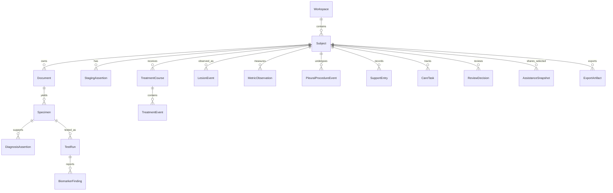

# 数据领域模型草案 v0.2

状态：设计用，不是DDL。概念从ovarian-workbench SCHEMA的稳定ID/证据引用/派生版本继承，但肺癌实体与临床语义另行定义。

## 实体图

Subject为个人患者或照护者本人（照护者心理记录归照护者主体）；家庭关系/谁可看由授权引用表达，不将亲缘自动当权限。

## 实体要点

| 实体 | 核心字段/约束 | 版本与来源 |
| --- | --- | --- |
| Workspace/Subject | 稳定ID、主体角色、别名、时区、创建/修订 | 主体和访谈记录操作者分开 |
| Document/DocumentVersion | hash、相对路径、MIME、原名、原件状态、报告机构/日期 | 重导/重解析新版本，原件不覆盖 |
| Specimen | specimen_id、reporting_subject、取材日期精度、解剖部位、方式原文、病理号、材料类型、来源文档 | 同一次穿刺可关联组织/细胞/血液等多个标本；样本状态/流转单独事件 |
| SpecimenEvent | 收集/送检/借片/补片/退还/不足等事件、机构、日期/操作者、原文 | 不把送检成功推断为样本合格 |
| TestRun | 标本、检测类别/平台/方法原文、实验室、检测范围、肿瘤含量/限制、报告版本、状态 | failed/insufficient/pending与完成分开 |
| DiagnosisAssertion | 原发部位、NSCLC/SCLC/混合/其他原文、组织学/IHC、原文诊断 | 多时间点并列，支持历史病理转化事件但需报告/临床来源 |
| StagingAssertion | TNM字段/总期、体系/版本、c/p/yp前缀；SCLC局限/广泛另存 | 同患者可保留多版本/临床与病理分期，不互相改写 |
| BiomarkerFinding | gene/alteration、HGVS/转录本/外显子/融合伙伴、变异类别、数值和单位、结果状态、原文 | 组织/血浆/其他样本不同；VUS/未知/未检测独立 |
| PD-L1Finding | 样本、抗体克隆/平台、TPS/CPS或其他体系原文、结果/单位 | 不与driver变异合并 |
| MetricDefinition/Observation | 检查代码/别名/值类型、结果/比较符/原始单位、参考范围、采样/报告时间精度 | CEA/NSE等不是癌种确认；值不能推疗效 |
| TreatmentCourse | 医嘱方案原文、治疗目的、组织学/阶段背景（引用，不复制）、线次未知允许 | 方案编辑产生版本 |
| TreatmentEvent | therapy_type、药物/剂量原文、计划/实际/暂停/完成、给药途径/周期、部位/放疗分次、来源 | 计划不等于给药；局部与系统疗法可并行 |
| LesionEvent | 部位、报告描述、比较对象/尺寸原文、疑似/报告/团队确认状态、关联治疗 | 肺内新病灶不自动判原发或转移 |
| PleuralProcedureEvent | 胸腔穿刺/置管/引流类别、目的（诊断/治疗/未知）、日期精度、侧别/部位原文、逐次量/单位、性状原文、机构、引流前后患者自述、关联细胞学/影像 | 每次操作单独事件，同日可多条；字段可空并保留来源，记录不推断恶性/疗效/复发/时机 |
| ReviewDecision | 具体claim_id/revision、accept/edit/reject/defer、执行者/日期/理由 | 用户核对不等于医学验证 |
| SupportEntry/CareTask | 主体/录入者、症状/进食/感受、发生时间、分享限制、实际联系/医嘱安排；可引用SurgeryEvent/TreatmentEvent暴露日期 | 低负担字段可空；手术前后活动自述标记本人自述/术前回忆；免疫暴露与症状关联仅作时间关联，不推断因果；不得把缺记录变正常 |
| KnowledgeResource/Indication | 来源/地区/版本/章节/条件/审核/有效期、监管事件/批准性质 | 公开知识和患者私有资料隔离 |
| Draft/Question/Brief | 引用的记录ID+版本+核对状态、问题/缺项/主体/隐私 | 派生状态/来源可重算或显旧，不复制成事实 |
| TrialRecord/Snapshot | 登记ID/版本/地区/招募状态/采集日、所对照患者记录版本 | 收藏保存历史快照；不产出入组结论 |
| AgentTask/ExportArtifact | 所选记录版本/资源ID、用户问题、发送权限/同意、真实MIME/路径/hash | 源更正后提示旧版，不覆盖既有输出 |

## 跨维度枚举（不可合并）

- `clinical_type`: `nsclc / sclc / combined / other_primary / metastasis_to_lung / unknown`（具体报告内容仍保留自由原文及版本化代码）。
- `result_state`: `detected / not_detected_within_assay / not_tested / pending / failed / insufficient / unknown / vus / below_detection_limit`；基因结果不同于检测流程状态。
- `review_state`: `candidate / accepted / rejected / needs_review / superseded`。
- `source_kind`: `report / pathology / clinician_document / patient_reported / caregiver_reported / knowledge_resource / agent_generated`。
- `event_status`: `proposed / ordered / scheduled / administered_or_performed / held / changed / completed / cancelled / unknown`，字段必须按事件类型限制适用值。
- `stage_system`: TNM版本、SCLC limited/extensive另为独立stage scheme；体系与版本必填才能比较。
- `privacy/share_scope`: `private_to_subject / selected_supporter / selected_brief / selected_agent / export_selected`；派生对象沿用其数据依赖中最严格限制。

日期保留精度、原时区和月/日未知状态。数值和文本结果分开，比较符与具体数值独立。VUS不是阳性用药结论；扩增、突变、融合、IHC表达分型不同。

## 事实和派生规则

业务所有者选择的目录内SQLite做事实库，原始文件独立管理。UI不拼SQL/绝对路径。所有写命令带workspace/subject、expected_revision、幂等键。批量接受需明确字段列表，事务写decision与新事实；冲突显示差异。

草稿由候选claim引用构成，不新建“草稿事实表”。接受字段改动影响当前读模型和依赖版本；过去导出/Agent结果保留快照。Agent/用户采纳产生新记录仍保存原source_kind。删除原件时显式列举断链引用，不继续显示可回源。

## 迁移与恢复

只在领域关系/状态语义改变时加递增迁移；新增指标走版本化目录，不改表。迁移前复制一致性备份；检测表/外键/文件引用；失败保留旧数据库与可恢复备份，禁止清库重建。SQLite WAL恢复及原件复制/链接语义需在API设计与目标Node验证。
